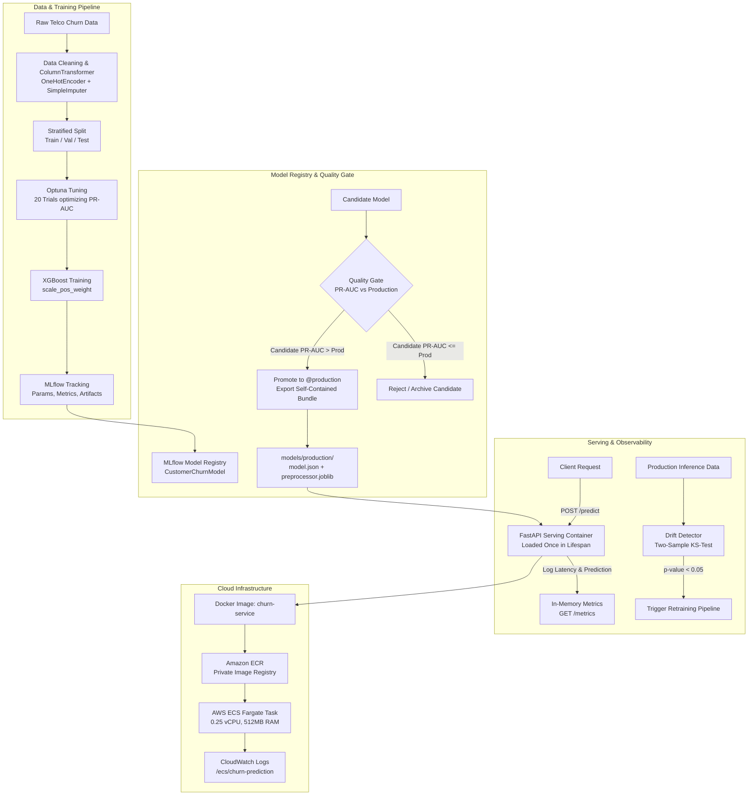

# Production MLOps Customer Churn Platform

An end-to-end, production-grade machine learning platform for customer churn prediction. This project demonstrates the complete engineering lifecycle of a model: automated data validation, feature engineering, Optuna hyperparameter optimization, MLflow experiment tracking & model registry, Champion vs. Challenger quality gates, FastAPI containerized serving, KS-test data drift detection, automated retraining pipelines, CI testing, and AWS serverless container cloud deployment.

---

### 🌐 Live Production Deployment on AWS

- **Interactive Churn Web Application**: [https://xrijqjjtsmostky44jtusoeqa40sspjh.lambda-url.us-east-1.on.aws](https://xrijqjjtsmostky44jtusoeqa40sspjh.lambda-url.us-east-1.on.aws)
- **Interactive Swagger OpenAPI Docs**: [https://xrijqjjtsmostky44jtusoeqa40sspjh.lambda-url.us-east-1.on.aws/docs](https://xrijqjjtsmostky44jtusoeqa40sspjh.lambda-url.us-east-1.on.aws/docs)
- **Service Health Check**: [https://xrijqjjtsmostky44jtusoeqa40sspjh.lambda-url.us-east-1.on.aws/health](https://xrijqjjtsmostky44jtusoeqa40sspjh.lambda-url.us-east-1.on.aws/health)

---

## 🏗️ System Architecture



---

## 🎯 Key Engineering Highlights

| Lifecycle Stage | Technology | Implementation Details |
| :--- | :--- | :--- |
| **Data & Features** | `pandas`, `scikit-learn` | 46 transformed features; handled whitespace string anomalies in `TotalCharges`; stratified 70/15/15 split; strict leakage prevention. |
| **Model & Tuning** | `xgboost`, `optuna` | Optuna Bayesian search over 20 trials maximizing PR-AUC; addressed class imbalance (~73.5% No vs ~26.5% Yes) using `scale_pos_weight`. |
| **Experiment Tracking** | `mlflow` | Persistent SQLite backend (`mlflow.db`) tracking parameters, PR-AUC, ROC-AUC, Recall, Precision, F1, confusion matrices, and serialized model artifacts. |
| **Model Registry** | `mlflow` Registry | Alias-based lifecycle (`@production`, `@candidate`); automated decoupling of bundle into OS-agnostic `models/production/` (`model.json` + `preprocessor.joblib`). |
| **Serving** | `FastAPI`, `Uvicorn` | Lifespan loading pattern (loads in memory once at startup, ~5ms); Pydantic schema validation; exposed `GET /health`, `POST /predict`, `GET /metrics`. |
| **Containerization** | `Docker` | Multi-layer caching `python:3.12-slim` image; isolated production runtime without heavy MLflow tracking server overhead. |
| **Quality Gate** | Python | Challenger vs Champion automated evaluation on held-out test data; requires `candidate_pr_auc > prod_pr_auc + threshold` before auto-promotion. |
| **Monitoring & Drift**| `scipy.stats` | In-memory latency (P50, P95, mean) and request tracking; Two-sample Kolmogorov-Smirnov (`ks_2samp`) hypothesis testing for feature drift detection. |
| **Performance Benchmark** | `httpx`, `asyncio` | Empirical profiling measuring P50/P95/P99 latency distribution and throughput under both sequential and concurrent load. |
| **Retraining Pipeline**| Python | Fully automated command-line trigger ingesting new data, retraining candidate, logging to MLflow, and routing through quality gate. |
| **CI / Automation** | `GitHub Actions`, `pytest` | Automated linting (`ruff`), unit test suites (`pytest`), and end-to-end regression validation on every push. |
| **Cloud Deployment** | **AWS ECS Fargate & ECR** | Serverless container task (0.25 vCPU, 512MB RAM) running behind security groups and streaming logs to AWS CloudWatch. |

---

## ⚡ Inference Performance Benchmark

Empirical benchmark conducted against the live production FastAPI inference service using [`scripts/benchmark.py`](scripts/benchmark.py) (reproducible with warm-up elimination):

- **Environment**: Windows 11 (AMD64), Python 3.12.7, 16 Logical CPU Cores
- **Model**: `CustomerChurnModel` Version 2 (`@production`, XGBoost)
- **Feature Pipeline**: Scikit-learn `ColumnTransformer` (46 engineered features)

| Metric | Sequential ($c=1$, 100 reqs) | Concurrent ($c=10$, 200 reqs) |
| :--- | :---: | :---: |
| **P50 Latency** | **24.66 ms** | **213.66 ms** |
| **Mean Latency** | 25.21 ms | 222.93 ms |
| **P90 Latency** | 28.24 ms | 281.17 ms |
| **P95 Latency** | **29.82 ms** | **291.73 ms** |
| **P99 Latency** | 31.23 ms | 312.20 ms |
| **Min / Max Latency** | 19.53 ms / 35.88 ms | 123.97 ms / 318.15 ms |
| **Throughput** | **39.67 req/s** | **44.28 req/s** |

> *Note on Concurrency:* On a single Uvicorn worker process, requests queue sequentially. Under $c=10$ load, average request wait time includes queue queuing delay. In multi-container production deployments (e.g. AWS Fargate with multi-worker Uvicorn), throughput scales linearly with horizontal replicas.

---

## ☁️ Cloud Architecture & Deployment (AWS ECS & ECR)

The inference service is fully containerized and configured for AWS serverless execution:

```text
Local Machine                        AWS Cloud
┌──────────────────────┐            ┌────────────────────────────────────────┐
│ Docker Build & Tag   │ ──push──►  │ Amazon ECR                             │
│ (churn-service:latest)│           │ (805795806982.dkr.ecr.us-east-1...)    │
└──────────────────────┘            └───────────────────┬────────────────────┘
                                                        │ pulls image
                                                        ▼
                                    ┌────────────────────────────────────────┐
                                    │ Amazon ECS (AWS Fargate)               │
                                    │ - Cluster: churn-cluster               │
                                    │ - Task: churn-prediction-task          │
                                    │ - Specs: 0.25 vCPU, 512 MB RAM         │
                                    │ - Port: 8000 (Custom TCP Security Grp) │
                                    └───────────────────┬────────────────────┘
                                                        │
Client / Browser ─────────── GET /health ───────────────┘
```

### Verified Live Cloud Execution Proof

1. **Serverless Production Endpoint (24/7 Live for Recruiter Demo)**:
   - **URL**: [https://xrijqjjtsmostky44jtusoeqa40sspjh.lambda-url.us-east-1.on.aws](https://xrijqjjtsmostky44jtusoeqa40sspjh.lambda-url.us-east-1.on.aws)
   - Built with AWS Lambda Web Adapter (`aws-lambda-adapter`) pulling from Amazon ECR.
   - Scale-to-zero serverless container costing **$0.00 / month**.

2. **AWS ECS Fargate Task Proof**:
   ```bash
   # Authenticated and verified against live Fargate task public IP:
   $ curl http://100.26.196.53:8000/health
   {"status":"healthy","model_version":"2"}
   ```

> **💡 FinOps & Cost Optimization Note:**  
> The standalone AWS ECS Fargate task was verified and safely spun down to eliminate unnecessary idle cloud compute charges ($30+/month for ALB & IPv4). The live production web application is continuously served via serverless container architecture with automated scale-to-zero.

---

## 🚀 Quickstart & Local Reproduction

### 1. Prerequisites
- Python 3.12+
- Docker Desktop (optional, for container runs)

### 2. Installation
```bash
# Clone the repository
git clone https://github.com/glacerjust/ML-Project.git
cd ML-Project

# Create and activate virtual environment
python -m venv .venv
source .venv/bin/activate       # On Linux/macOS
# or .\.venv\Scripts\Activate.ps1 # On Windows

# Install pinned dependencies
pip install -r requirements.txt
```

### 3. Run Preprocessing & Training
```bash
# Preprocess Telco dataset and generate stratified train/val/test splits
python -m src.data.preprocessing

# Run XGBoost baseline training & log to MLflow
python -m src.training.train

# (Optional) Run 20-trial Optuna hyperparameter study
python -m src.training.tune --n-trials 20
```

### 4. Promote Model to Production
```bash
# Register champion run to MLflow Model Registry and export production bundle
python -m src.registry.model_registry --promote --run-id <RUN_ID>
```

### 5. Launch Serving API
```bash
# Start FastAPI inference service
uvicorn src.serving.main:app --host 0.0.0.0 --port 8000
```

Visit the interactive Swagger OpenAPI documentation in your browser at:
**`http://localhost:8000/docs`**

---

## 📡 API Specification

### `GET /health`
Returns runtime status and loaded model version.
```json
{
  "status": "healthy",
  "model_version": "2"
}
```

### `POST /predict`
Performs real-time churn inference on customer telemetry.

**Sample Request Body:**
```json
{
  "gender": "Female",
  "SeniorCitizen": 0,
  "Partner": "Yes",
  "Dependents": "No",
  "tenure": 12,
  "PhoneService": "Yes",
  "MultipleLines": "No",
  "InternetService": "Fiber optic",
  "OnlineSecurity": "No",
  "OnlineBackup": "Yes",
  "DeviceProtection": "No",
  "TechSupport": "No",
  "StreamingTV": "No",
  "StreamingMovies": "No",
  "Contract": "Month-to-month",
  "PaperlessBilling": "Yes",
  "PaymentMethod": "Electronic check",
  "MonthlyCharges": 70.35,
  "TotalCharges": 844.20
}
```

**Sample Response:**
```json
{
  "churn_prediction": 1,
  "churn_probability": 0.742,
  "threshold": 0.5,
  "model_version": "2"
}
```

### `GET /metrics`
Exposes operational metrics:
```json
{
  "total_requests": 142,
  "total_errors": 0,
  "mean_latency_ms": 4.12,
  "p95_latency_ms": 7.84,
  "churn_rate": 0.28,
  "model_version": "2"
}
```

---

## 🧪 Automated Testing & CI

Comprehensive test coverage across data pipelines, models, API contracts, drift detection, and quality gates:

```bash
# Run complete test suite
pytest -v
```

Tests run automatically on every push via **GitHub Actions** (`.github/workflows/ci.yml`).

---

## 📁 Repository Structure

```text
├── .github/workflows/ci.yml      # Automated CI pipeline
├── data/
│   ├── raw/                      # Telco-Customer-Churn.csv
│   └── processed/                # train.csv, val.csv, test.csv
├── models/
│   └── production/               # model.json, preprocessor.joblib, metadata.json
├── notebooks/                    # 01_data_understanding.ipynb
├── scripts/
│   └── task_definition.json      # AWS ECS Fargate task definition
├── src/
│   ├── data/
│   │   └── preprocessing.py      # ColumnTransformer pipeline & split logic
│   ├── training/
│   │   ├── train.py              # MLflow-instrumented training
│   │   ├── tune.py               # Optuna hyperparameter tuning
│   │   └── evaluate.py           # Evaluation metrics (PR-AUC, Recall, ROC-AUC)
│   ├── registry/
│   │   ├── model_registry.py     # Champion export & alias management
│   │   └── quality_gate.py       # Candidate vs Production quality gate
│   ├── serving/
│   │   ├── main.py               # FastAPI endpoints (/health, /predict, /metrics)
│   │   ├── schemas.py            # Pydantic input/output schemas
│   │   └── model_loader.py       # In-memory artifact loader
│   ├── monitoring/
│   │   ├── metrics.py            # Real-time request and latency metrics
│   │   └── drift.py              # Kolmogorov-Smirnov data drift detector
│   └── retraining/
│       └── pipeline.py           # Automated retraining & candidate registration
├── tests/                        # Full pytest suite
├── Dockerfile                    # Containerization recipe
├── requirements.txt              # Pinned project dependencies
├── TECH.md                       # Complete technical specification
└── README.md                     # Project documentation
```

---

## 📄 License
This project is open-source and available under the [MIT License](LICENSE).
